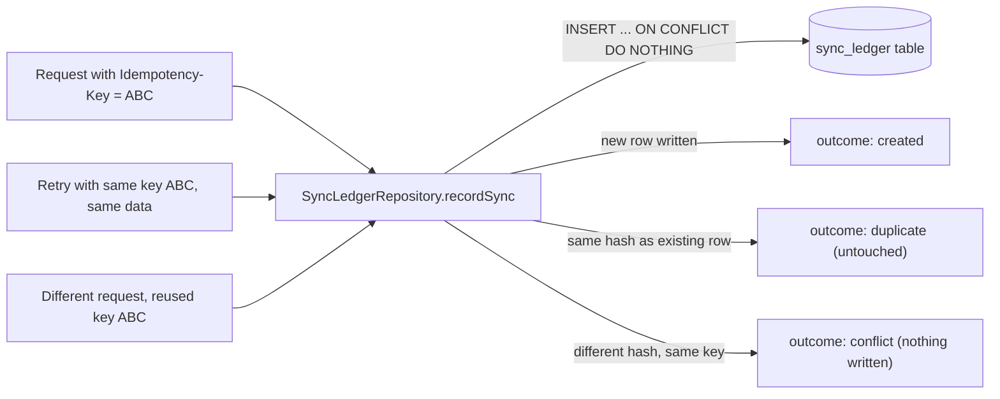

# Learning log
One lesson per finished stage, newest at the bottom.

## Stage 1: Domain model and anti-corruption layer

### 1. The story
When your distribution business took orders from different customers, each one's paperwork looked different: some weighed goods in kilograms, some counted cases, some called a product "SKU-100" and others "Widget Red-100". You likely had one intake clerk whose only job was to translate every incoming order into your own standard format before it ever touched the warehouse system -- so the rest of the business never had to relearn a new format for every customer. This bridge project does the same thing in code. Salesforce (the sales side) and ERPNext (the accounting side) each have their own data shapes and vocabulary, and one small, clearly marked piece of code -- the adapter -- is the only place allowed to speak either vendor's language. Everything else only ever sees our own plain "Deal", "Customer" and "Invoice" shapes, so if a vendor changes a field name tomorrow, only the adapter has to change.

### 2. New terms
- Domain model: our own plain description of the business objects (Deal, Customer, Invoice) that has nothing to do with any particular vendor's software.
- Anti-corruption layer: a small, deliberately isolated piece of code that translates an outside system's data into our own domain model, so the outside system's quirks never spread into the rest of the code.
- Adapter: the actual folder where that translation happens for one specific vendor (the Salesforce adapter, the ERPNext adapter).
- Zod schema: code that both describes the shape of data (which fields, what types) and checks real data against that shape while the program runs, rejecting anything that does not fit.
- Mapper: a function that takes data in one shape and produces data in another shape, for example turning a raw Salesforce Opportunity into our own Deal.
- Result type: a way for a function to return either a successful value or a list of error messages, instead of throwing an exception.
- Minor units (integer cents): storing money as a whole number of the smallest unit (cents) instead of a decimal number, so the computer never has to round a fraction.
- Blind review: a second pass where a reviewer checks the finished work against the written spec without being told in advance what to look for, to catch gaps the builder missed.

### 3. How it works
```mermaid
flowchart LR
    SF["Salesforce Opportunity + Account (raw)"] -->|mapOpportunityToDeal| ADPT_SF[Salesforce adapter]
    ADPT_SF -->|validated and converted| DEAL[("Deal" domain object)]
    DEAL -->|dealToCustomer / dealToInvoice| DOM[("Customer" + "Invoice" domain objects)]
    DOM -->|mapCustomerToErpPayload / mapInvoiceToErpPayload| ADPT_ERP[ERPNext adapter]
    ADPT_ERP --> ERP["ERPNext Customer + Sales Invoice payload"]
```
Raw Salesforce data enters only through the Salesforce adapter, which checks every field, converts money and dates, and either hands back a clean `Deal` or a list of plain-English errors -- it never does both halfway. Past that point, nothing in the code knows Salesforce exists; two small functions (`dealToCustomer`, `dealToInvoice`) turn the `Deal` into a `Customer` and an `Invoice` using only our own types. The ERPNext adapter is the only place that knows how ERPNext wants its fields shaped, and it only ever runs on these clean domain objects, never on raw Salesforce data. A linting rule backs this up by blocking vendor-specific imports outside the two adapter folders.

### 4. Where it lives
- Read first: `api/src/bridge/domain/deal.ts` (the Deal/Customer/Invoice shapes)
- Then: `api/src/bridge/domain/money.ts`, `api/src/bridge/domain/normalise.ts`, `api/src/bridge/domain/result.ts`
- Then: `api/src/bridge/adapters/salesforce/mapper.ts` and `types.ts`
- Then: `api/src/bridge/adapters/erpnext/mapper.ts` and `types.ts`
- Decisions and reasoning: `docs/bridge/MAPPING.md`
- Tests: `api/test/bridge/domain/*.test.ts` and `api/test/bridge/adapters/*.test.ts`
- The review that found a gap before the stage was marked done: `docs/bridge/reviews/stage-1-round-1.md`

### 5. Interview soundbite
"In a personal project, I built an anti-corruption layer so Salesforce and ERPNext types never leak outside two adapter folders -- everything else uses my own Deal, Customer and Invoice types. I stored money as integer cents instead of decimals to avoid rounding bugs, and a blind review caught a test-coverage gap in my line-item validation before I called the stage done."

### 6. Try it yourself (optional, ~20 minutes)
Open `api/src/bridge/adapters/salesforce/mapper.ts` and `api/test/bridge/adapters/salesforce-mapper.test.ts` side by side. Pick one validation rule you can see in the mapper (for example, "must have a quantity greater than 0") and write a small test input that should trigger it, following the pattern of the existing tests. Run `npx vitest run` inside `api/` and check that your new test passes and reports the exact error message.

### 7. Check yourself
<details>
<summary>Q1: Why is money stored as integer cents (e.g. 125050) instead of a decimal like 1250.50?</summary>
Computers cannot represent every decimal fraction exactly in binary, so repeated math on decimal numbers slowly introduces rounding errors. A whole number of cents has no fraction to round, so the math stays exact.
</details>
<details>
<summary>Q2: What is the one rule the anti-corruption layer enforces about Salesforce and ERPNext types?</summary>
Those vendor-specific types may only be imported inside the salesforce/ and erpnext/ adapter folders; every other file in the project only sees our own Deal, Customer and Invoice types.
</details>
<details>
<summary>Q3: What did the blind review catch in Stage 1, and why did it matter?</summary>
It found that four error paths in the line-item validation (for example, a zero quantity or a bad discount percentage) had no test covering them, so a future bug in that code could ship without any test ever failing.
</details>

## Stage 2: Sync ledger and idempotency

### 1. The story
Imagine a customer calls your warehouse twice in one afternoon to place "the same order" -- maybe their phone dropped the call and they just redialed. A careful order clerk does not create a second shipment; she checks her order book for that customer's order number, sees it is already there, and simply tells the customer "already on it." But if a different customer somehow got given a number that was already in the book, she would stop and flag it, because something is wrong, not just repeated. The sync ledger in this stage is that order book: every deal that tries to flow from Salesforce to ERPNext gets logged under its own unique ticket number (the idempotency key) before any real work happens, so a retried request finds its own entry and quietly does nothing twice, while a genuinely different request that tries to reuse someone else's ticket number gets caught and rejected.

### 2. New terms
- Sync ledger: a single database table that records every attempt to move a deal from Salesforce to ERPNext, so the system always knows what it already did.
- Idempotency key: a unique ticket number the caller attaches to one logical request, used to tell "the same request, sent twice" apart from "two different requests."
- Idempotent: a property of an action where doing it once or doing it many times with the same key has the exact same end result.
- Payload hash: a short fingerprint (computed with a one-way scrambling function called SHA-256) of the exact data sent, used to check whether a retried request really carries the same data as before.
- Migration: a small file of database changes (like "create this table") that is run once and recorded, so the database's structure can be built up safely over time instead of by hand.
- Expand/contract migration: a rule that a migration only ever adds things (a new table, a new column) and never edits or deletes an existing one; removing something old happens in its own later, separate migration.
- Repository (the coding pattern): a class whose only job is reading and writing one kind of database row, so the rest of the code never writes raw SQL.
- Race condition: a bug that only shows up when two things happen "at the same time," where the order they finish in changes the result.
- Advisory lock: a flag a database can hold for you so that only one process at a time runs a certain piece of code, even if several processes try at once.

### 3. How it works

Every attempt goes through one database statement, `INSERT ... ON CONFLICT (idempotency_key) DO NOTHING`, which Postgres guarantees is atomic -- meaning it cannot be split in half, so two requests racing with the exact same key can never both succeed in creating a row. Whichever one the database lets insert gets "created"; everyone else falls through to a lookup and compares the stored payload hash against their own. If the hash matches, that caller gets "duplicate" and the row is left alone; if it does not match, that caller gets "conflict," because someone reused a ticket number for different data. The table itself is built by a migration file that only ever adds things, and a Postgres advisory lock stops two app instances from trying to set up the migrations tracking table at the exact same moment.

### 4. Where it lives
- Read first: `api/src/bridge/ledger/repository.ts` (the create/duplicate/conflict logic)
- Then: `api/migrations/0001_create_sync_ledger.sql` (the table shape)
- Then: `api/src/bridge/ledger/hash.ts` (how the payload fingerprint is computed), `api/src/bridge/ledger/migrate.ts` (how migrations are run safely)
- Then: `api/src/bridge/ledger/types.ts` and `api/src/bridge/ledger/settings.ts` (the shapes stored in each row)
- Local database setup: `api/docker-compose.bridge-db.yml`
- Tests: `api/test/bridge/ledger/repository.test.ts` (runs against a real local Postgres, not a fake one), `api/test/bridge/ledger/*.test.ts`
- Decisions and reasoning: `docs/bridge/MAPPING.md`

### 5. Interview soundbite
"In a personal project, I built a sync ledger so retried requests are idempotent: the same idempotency key with the same data always returns the same result, and the same key with different data is rejected as a conflict, using one atomic `INSERT ... ON CONFLICT DO NOTHING` so this stays correct even when duplicate requests arrive at the same time. I also wrote the schema as an expand-only migration, so later changes can never silently rewrite history."

### 6. Try it yourself (optional, ~20 minutes)
Open `api/test/bridge/ledger/repository.test.ts` and read the test called "handles concurrent duplicate inserts safely." Change the number of concurrent calls from 10 to, say, 50, and run `npx vitest run test/bridge/ledger/repository.test.ts` inside `api/` (you will need the local Postgres container running first -- see `api/docker-compose.bridge-db.yml`). Confirm the test still reports exactly one "created" result and the rest as "duplicate," no matter how many you run at once.

### 7. Check yourself
<details>
<summary>Q1: What is the difference between a "duplicate" result and a "conflict" result in the sync ledger?</summary>
A "duplicate" is the same idempotency key sent again with the exact same data (the payload hash matches) -- it is treated as a harmless retry. A "conflict" is the same idempotency key sent with different data (the hash does not match) -- that is rejected because the key is supposed to identify one specific request.
</details>
<details>
<summary>Q2: Why does one atomic database statement matter here, instead of first checking "does this key exist?" and then inserting if not?</summary>
Checking first and inserting second leaves a tiny gap in time where two requests could both see "it doesn't exist yet" and both try to insert, creating two rows for the same key. One atomic `INSERT ... ON CONFLICT DO NOTHING` closes that gap because the database itself guarantees only one of the racing inserts can win.
</details>
<details>
<summary>Q3: What does "expand/contract" mean for the migration file, and why is it a rule rather than a suggestion?</summary>
It means a migration only ever adds new things (tables, columns) and never edits or removes something an older migration already created; removing something old is always its own later, separate migration. The rule matters because editing an already-run migration can leave different environments with different table shapes depending on when they last ran it, which is a hard class of bug to track down.
</details>
